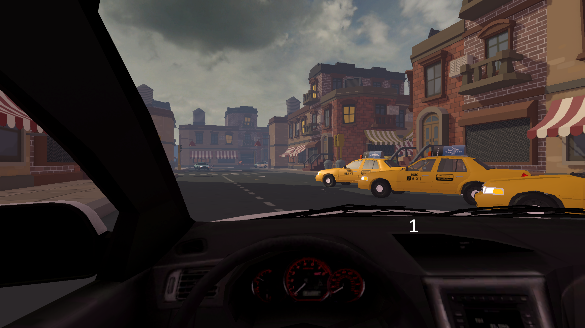
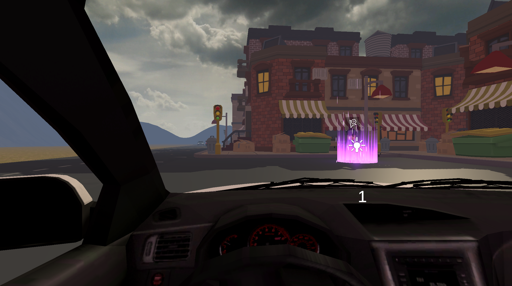
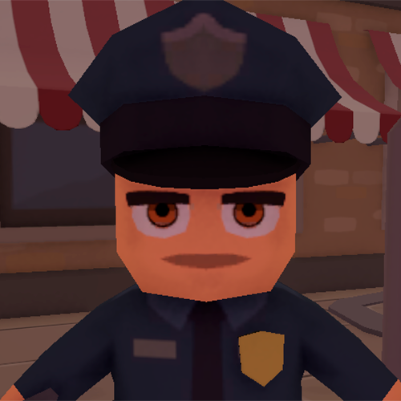
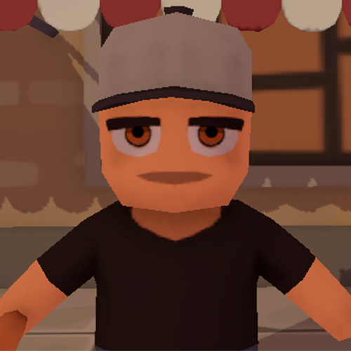
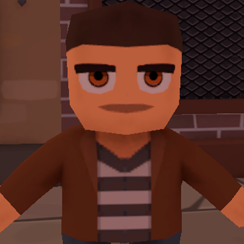
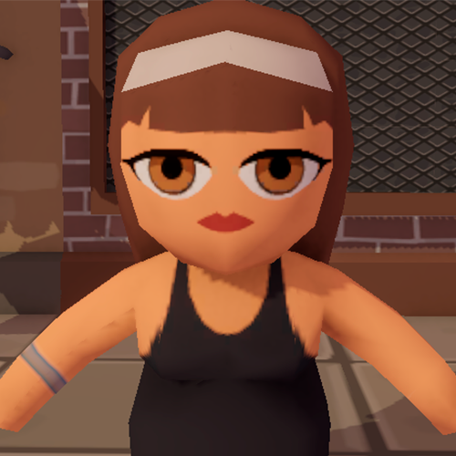

# WwDriveRacing

**A VR city driving simulator where you feel the car with your body: a bHaptics haptic vest and a 2DOF motion platform.**
You get behind the wheel in a headset, start the engine, press the clutch and learn to pull away. Then comes a route of delivery orders: every city resident is waiting for you at their own point. Acceleration and braking tilt the seat, turns make it roll, and a hit to the bumper reaches your back and chest through the vest. The picture in the headset is only half of the simulator; the other half works with hardware.

<p align="left">
  
  
  
  
  
  
  
  
</p>

<p align="center">
  
</p>

<p align="center"><i>Everything happens from behind the wheel. The current gear number is shown on the dashboard right in front of your eyes.</i></p>

<p align="center">
  
</p>

<p align="center"><i>The current order point is visible from afar: a pillar of light with a marker above it, turned toward the driver.</i></p>

---

## What the Player Feels

| 🦺 bHaptics SDK2 | 🎢 2DOF Platform |
|---|---|
| The vest plays hits, completed orders, new messages and menu presses. The hit side is calculated from the contact point, so a head-on hit and a hit from behind feel different. | The seat follows the car: acceleration pushes it back, braking forward, a turn makes it roll. A collision adds a separate jolt that fades out by itself. |
| In-game events: **7** | Telemetry rate: **50 Hz** |

Both technologies are not plugged in as demo stubs but connected to live physics events: the car's `Rigidbody` and its collisions are the only data source for both the vest and the platform.

---

## bHaptics Haptic Vest

bHaptics SDK2 is not a separate layer on top of the game but part of the game logic: the calls sit right in the collision handler, the order system and the tutorial panels.

| Event | When it fires |
|---|---|
| `frontcrash` | hit to the front of the car |
| `backcrash` | hit to the rear |
| `processcompleteorder` | order completed |
| `message` | a new customer appeared |
| `righthand`, `butterfly` | interaction with tutorial panels |

The hit side is found by converting the contact point into the car's local coordinates: positive Z means a head-on hit, negative Z means a hit from behind. So the vest hits exactly where the impact happened instead of playing one generic pattern for any touch.

Patterns are stored in the project and generated into `BhapticsEvent` constants through the SDK editor, so event names in the code and in bHaptics Player always match.

## 2DOF Motion Platform

The platform gets telemetry directly from the car physics, without an intermediate game layer.

- **Pitch** comes from longitudinal acceleration: accelerating tilts the seat back, braking tilts it forward.
- **Roll** comes from lateral acceleration, i.e. the real side G-force in a turn.
- **Impact** adds a separate pitch impulse and a random roll based on the collision force, then smoothly fades out by itself.
- **Limits** keep both angles within 10° and smooth them so the seat does not jerk on small bumps.

The final angles and the velocity vector are packed into an array of six numbers and written every 20 milliseconds, i.e. 50 times per second, to Windows shared memory named `2DOFMemoryDataGrabber`. Sending runs in a separate thread and does not affect frame rate. The platform app reads this memory by itself, so the game needs no drivers and no network.

---

## Customers

| | | | |
|---|---|---|---|
|  |  |  |  |
| Order 1 | Order 2 | Order 3 | Order 4 |

Each customer appears on the cockpit panel together with their marker on the city map. Once the order is done, the portrait, the marker and the route target all change.

---

## How a Ride Works

**Tutorial.** The player goes through a chain of panels, and each one waits for the actual action rather than a "next" button:

1. Welcome and the first screen, then continue with a button.
2. Press the clutch and shift into first gear.
3. Press the gas.
4. Press the brake.

Until the action is done, the next panel does not appear, so you cannot start driving without figuring out the gearbox.

**Orders.** `CheckpointSystem` keeps a list of four points. Only one is active at a time: as soon as the car enters the `2.8 m` radius, the point turns off, the order-completed haptic feedback plays, and the next portrait and marker turn on. After the fourth point, the final text appears on screen.

**Markers.** The pointers above the city always face the camera and grow with distance so that a far target stays readable from the cockpit. This uses a billboard with distance-based scaling, separate from the order logic itself.

## Gearbox

The car will not drive "by itself": movement fully depends on the clutch and the gear.

- Gears shift only with the clutch pressed, between neutral, reverse and five forward gears.
- Engine RPM is calculated from the rear wheel RPM through the gear ratio and the final drive. In neutral and with the clutch pressed, it drops to idle.
- Each gear has its own speed cap. Shift down at too high a speed and forced braking kicks in, with the gas disabled for that time.
- Traction depends on RPM: below 1500 and above 5500 the torque is cut, the optimal range is 1500 to 4500.
- You cannot pull away in fourth: in a high gear at low speed, power drops to 10–30%.
- Steering is sharper the slower the car goes. At speed, the wheel steering angle decreases.

| Gear | R | 1 | 2 | 3 | 4 | 5 |
|---|---|---|---|---|---|---|
| Speed cap, km/h | 8 | 10 | 20 | 30 | 40 | 50 |

The steering wheel model in the cockpit turns with the wheels up to 180°, the wheels are visually synced with `WheelCollider`, and downforce grows with speed.

## Controls

| Keyboard | Action |
|---|---|
| `W` / `S` | gas and brake |
| `A` / `D` | steering |
| `Space` | handbrake |
| `Left Shift` | clutch |
| `E` / `Q` | gear up and down |

A separate control branch is made for the **Logitech G29**: the wheel, three pedals and the seven-position shifter are read through the Input System, the gear is engaged with the physical lever, and releasing the lever returns to neutral. This controller version has six gears with a speed cap of up to 180 km/h. In the scene the component sits next to the keyboard one and is disabled by default; enable it instead of the keyboard one.

## Sound

The engine sound is built from three layers: start, idle and acceleration. The layers crossfade based on RPM, speed and throttle position, and the acceleration pitch follows the RPM. Master volume goes through an `AudioMixer`; the menu slider saves it to `PlayerPrefs` so it survives a restart, and the sound manager itself is not unloaded between scenes.

## Tech Stack

**bHaptics SDK2** (haptic vest) · **2DOF** (motion platform, memory-mapped file) · **Logitech G29 SDK** (wheel, pedals, shifter)

Unity 6 (URP 17.2) · OpenXR + XR Interaction Toolkit 3.2 · Input System · TextMesh Pro

## Project Structure

```
Assets/
├─ Scripts/
│  ├─ CarDriving/     car physics, gearbox, clutch, steering
│  ├─ Orders/         order points, portraits, billboard markers
│  ├─ Tactilka/       haptic collision events
│  ├─ menu/           tutorial slides and scene transitions
│  └─ soundScripts/   mixer, volume, engine sound
├─ Plugins/
│  ├─ LogitechG29/    wheel, pedals and shifter via Input System
│  └─ 2DOF/           sending telemetry to the motion platform
├─ Sample/            wheel control variant + platform telemetry
├─ Bhaptics/          haptic vest SDK2
├─ City/ Enviroments/ city, terrain, skybox, water, effects
└─ AS_Cars/           player and traffic car models
```

Scenes: `GameMenu` (start, volume, exit) → `MainScene` (tutorial, city and orders).

## Getting Started

1. Unity **6000.0.40f1**, build platform: Windows Standalone.
2. An OpenXR-compatible headset is connected before entering Play Mode.
3. **bHaptics.** You need bHaptics Player running with the patterns loaded and the vest connected. Without it the game still works, there is just no haptic feedback.
4. For the Logitech G29 wheel, enable the wheel control component on the car instead of the keyboard one.
5. **2DOF.** The platform connects by itself as soon as its app starts reading the `2DOFMemoryDataGrabber` shared memory. No extra setup is needed in the game.

---

© D.Baranov Universe
